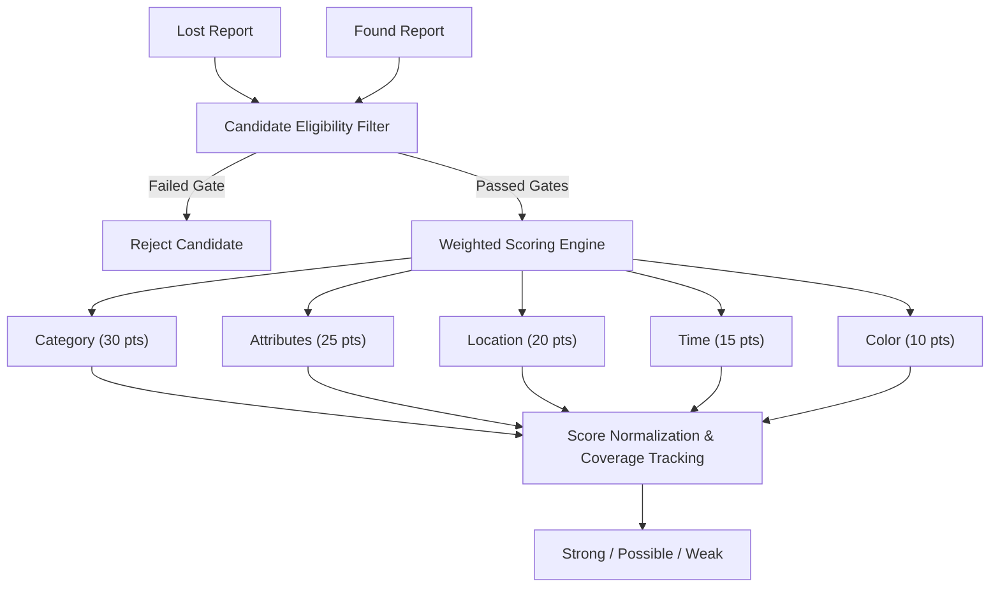
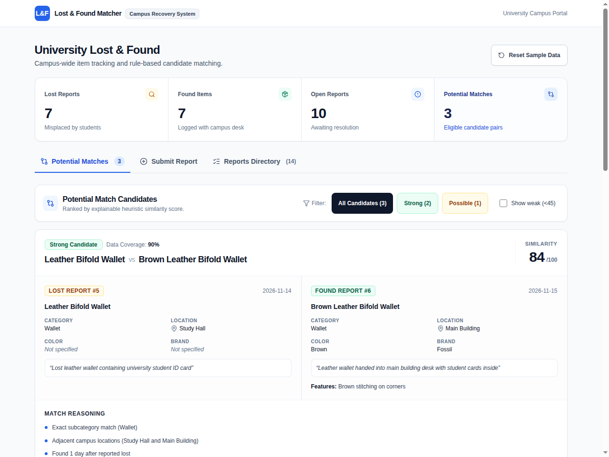
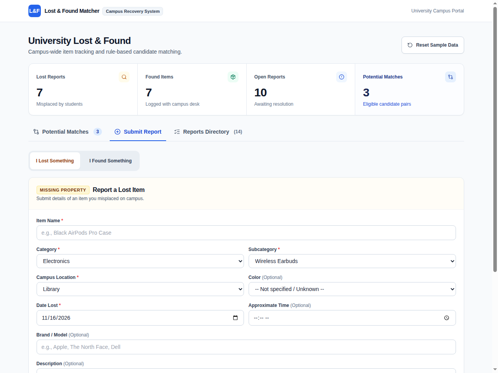
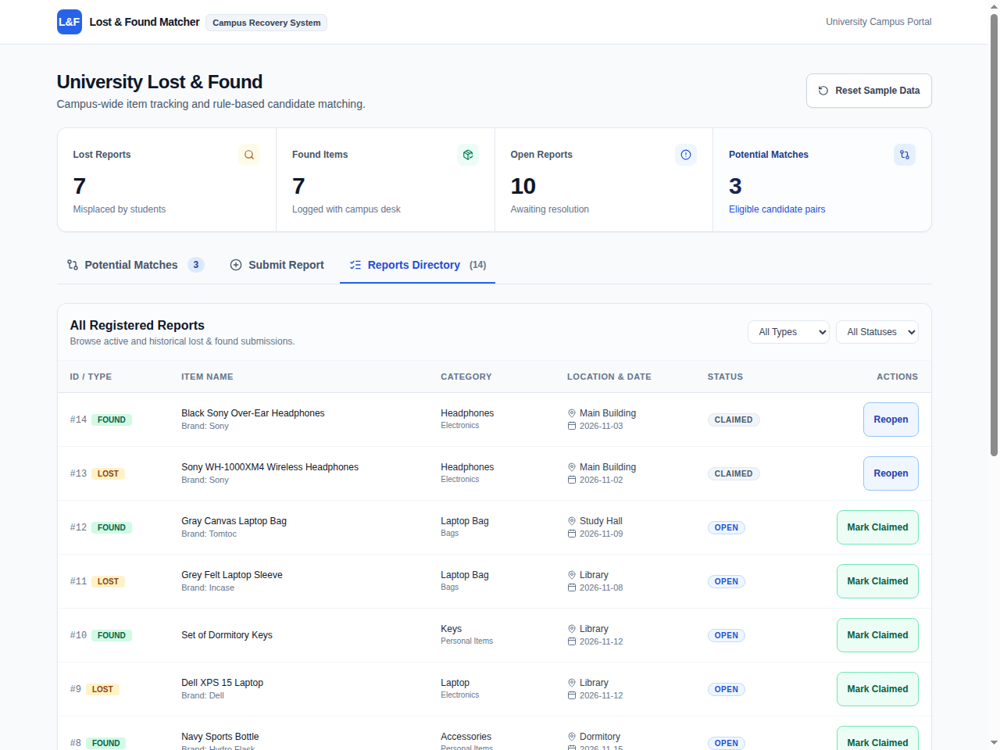

# University Lost & Found Matcher

An explainable, rule-based matching engine and web application that connects university students with their lost items. Built with **React 19, TypeScript, Express, and SQLite**, utilizing heuristic similarity scoring and transparent reasoning rather than black-box AI embeddings.

> **Important Statement**  
>  
> The matching score is a heuristic similarity score, not a probability that two reports refer to the same physical item. It is designed to rank potential matches and support human review rather than automatically establish ownership.

> [!NOTE]
> Detailed answers to all pre-implementation design and architecture questions across scope, data models, algorithm, lifecycle, confirmation, database, and performance are documented in [DESIGN_DECISIONS.md](DESIGN_DECISIONS.md).

---

## 1. Project Overview

Every semester on a busy university campus, hundreds of personal items (laptops, wireless earbuds, ID cards, bags, and water bottles) are misplaced. Traditional physical logbooks and unstructured digital noticeboards suffer from low recovery rates because:

1. Reports are filed in disparate locations across different days.
2. Item descriptions vary in terminology and completeness.
3. Students and staff lack an automated, explainable way to detect when a lost item report aligns with an item handed into campus security.

The **Lost & Found Matcher** resolves this by providing a single-page web portal where students can submit lost/found reports, immediately inspect ranked match candidates, view clear justifications for why items matched, and confirm or dismiss suggestions.

---

## 2. Main Features

- **Dual Report Submission Forms**: Structured dropdowns for categories, subcategories, colors, and locations paired with free-text fields for unique item names, brands, descriptions, and distinguishing features.
- **Explainable Weighted Matching**: Heuristic scoring engine evaluating category compatibility, distinctive attributes, location proximity, time proximity, and color similarity.
- **Transparent Reasoning**: Every candidate match generates itemized, human-readable explanations detailing why the reports were paired.
- **Coverage Tracking**: Missing details do not automatically lower the score. The system tracks how much information was available separately.
- **Candidate Filtering**: Strict gates enforce temporal order (found $\ge$ lost), active report status, 30-day candidate window, category compatibility, and quarantine of dismissed pairs.
- **Human Confirmation**: An atomic SQLite transaction updates both reports from `open` to `claimed` upon human verification, preventing duplicate claims or re-suggestions.
- **Permanent Dismissal**: Irrelevant suggestions can be dismissed with a single click, storing the pair in SQLite to prevent reappearance.
- **Reports Directory**: Search and filter current and historical reports across campus by type and status.
- **One-Click Benchmark Reset**: Instant database reset and re-seed mechanism for reviewer demonstration.

---

## 3. Technology Stack

| Component | Technology | Rationale |
|---|---|---|
| **Frontend** | React 19 | Component reusability, modular architecture, responsive state |
| **Frontend Language** | TypeScript | End-to-end type safety with strict compiler options |
| **Build Tool** | Vite 6 | Fast HMR in development, optimized production bundling |
| **Styling** | Tailwind CSS 3 | Utility-first styling for accessible, clean university UI |
| **Backend** | Node.js (v18+) & Express 4 | Lightweight, event-driven RESTful API layer |
| **Backend Language** | TypeScript | Type safety synchronized with frontend models |
| **Database** | SQLite via `better-sqlite3` | Zero-configuration file database, synchronous high performance |
| **Input Validation** | Zod | Runtime type safety and schema validation for API inputs |
| **Text Similarity** | Fuse.js | Fast, deterministic token and fuzzy text matching |
| **Testing** | Vitest | Sub-second algorithmic unit and database integration testing |
| **API Client** | Native Fetch API | Modern, zero-dependency browser HTTP communication |

---

## 4. Architecture Overview

The repository is organized as a clean TypeScript monorepo with strict separation between client presentation, REST routing, and algorithmic matching logic:

```text
lost-and-found/
├── client/                     # Single-Page React Application
│   ├── src/
│   │   ├── components/         # ReportForm, MatchCard, MatchList, ReportList, DashboardStats
│   │   ├── pages/              # Dashboard view
│   │   ├── services/           # Typed API communication (api.ts)
│   │   ├── types/              # Domain interfaces
│   │   ├── App.tsx             # Root layout & navigation
│   │   └── main.tsx            # Entry point
│   ├── index.html
│   └── package.json
│
├── server/                     # Lightweight Node.js Express REST API
│   ├── src/
│   │   ├── config/             # Category taxonomy, campus locations, color groups
│   │   ├── database/           # SQLite setup (db.ts), schema.sql, and seed script (seed.ts)
│   │   ├── routes/             # Express routes (/api/reports, /api/matches)
│   │   ├── services/           # Matcher (matcher.ts), scoring rules (scoring.ts), text similarity (textSimilarity.ts)
│   │   ├── validation/         # Zod schemas (report.schema.ts)
│   │   ├── app.ts              # Express configuration & metadata endpoints
│   │   └── server.ts           # Server listener
│   └── package.json
│
├── tests/                      # Vitest test suite for scoring & candidate filtering
├── screenshots/                # Application UI captures
├── .env.example                # Sample environment configuration
├── package.json                # Root npm workspace orchestration
└── README.md
```

---

## 5. Matching Algorithm and Scoring

The matcher is deterministic and rule-based, with a maximum score of **100 points**. It first filters out ineligible candidates, then scores the remaining reports.



### Scoring Components

| Component | Weight | Criteria & Tiers |
|---|:---:|---|
| **Category Compatibility** | **30 pts** | Exact subcategory: 100%; same parent category: 70%; related category: 40%; incompatible categories are rejected. |
| **Distinctive Attributes** | **25 pts** | Fuse.js compares title, brand, description, and distinguishing features with stop-word removal and token normalization. |
| **Location Proximity** | **20 pts** | Same location: 100%; adjacent locations: 80%; same campus area (parent): 50%; distant location: 10%. |
| **Time Proximity** | **15 pts** | Soft decay: Same day (100%), 1 day (90%), 2 days (80%), 3–5 days (65%), 6–10 days (40%), 11–14 days (20%), 15–30 days (10%). |
| **Color Similarity** | **10 pts** | Exact match or same color group: 100%; "dark" vs "black" heuristic: 60%; different colors: 0%. Missing colors are excluded. |

---

## 6. Candidate Eligibility Rules

A report pair must pass these hard filtering checks before it is scored:

1. **Date order:** The found date must be on or after the lost date ($date_{found} \ge date_{lost}$).
2. **Open status:** Only reports with `open` status are considered.
3. **Category compatibility:** Unrelated categories, such as a backpack and headphones, are rejected.
4. **30-day window:** The time difference must be between 0 and 30 days ($0 \le \Delta t \le 30$).
5. **Dismissed pairs:** Pairs previously dismissed are stored in SQLite and excluded from future suggestions.

> **Design decision:** Location and color are not hard filters. Items can be moved around campus, and colors may be remembered or described differently.

---

## 7. Match Score and Information Coverage

A missing detail, such as color or brand, does not automatically reduce the match score. The score is calculated using the components that are available:

$$S = \frac{\sum_{i \in A} w_i s_i}{\sum_{i \in A} w_i} \times 100$$

Here, $A$ is the set of available comparison components, $w_i$ is each component's weight, and $s_i$ is its similarity score ($0.0 \le s_i \le 1.0$).

Information coverage is tracked separately:

$$C = \frac{\sum_{i \in A} w_i}{100} \times 100$$

### Match Classifications

In alignment with probabilistic entity resolution standards (Fellegi-Sunter methodology), candidate pairs are categorized into three distinct confidence tiers to balance recall and review queue precision:

- **Strong:** Score $\ge 70$ and coverage $\ge 60\%$. High confidence candidate where core distinguishing features align.
- **Possible:** Score $\ge 60$, or score $\ge 70$ with coverage below $60\%$. Moderate confidence candidate flagged for manual human inspection. Lowering thresholds below 60% tends to introduce excessive noise from coincidental overlaps (e.g., matching category but separated by weeks or opposite sides of campus).
- **Weak:** Score below 60. Coincidental or weak similarities, hidden from the primary suggestion feed by default (toggleable via the UI).

---

## 8. Human Confirmation Workflow

1. **Autonomous Suggestion:** The matcher scores eligible reports and ranks candidate pairs.
2. **Human Review:** A student or staff member compares the reports, details, and transparent reasons behind the suggestion.
3. **Decision Pathways:**
   - **Confirm Match:** Sends `POST /api/matches/confirm`. An atomic SQLite transaction changes both reports from `open` to `claimed`. They are then removed from active suggestions. A repeat confirmation is safely rejected.
   - **Dismiss:** Sends `POST /api/matches/dismiss`. The pair is saved in `dismissed_matches` with a unique constraint, so it will not be suggested again.

---

## 9. Installation Instructions

### Prerequisites

- Node.js $\ge 18$ (tested with v22.14.0)
- npm $\ge 9$

### Setup

```bash
# Clone the repository
git clone https://github.com/natinael96/lost_and_found-nemma-proj.git
cd lost_and_found-nemma-proj

# Install dependencies for all workspaces
npm install
```

---

## 10. Environment Variables

Create a `.env` file in the project root if you need to override the defaults (see `.env.example`):

```bash
# Server Configuration
PORT=3001
NODE_ENV=development

# Database Configuration (Optional: defaults to ./lost_and_found.db in project root)
# DATABASE_PATH=/path/to/custom_lost_and_found.db

# Client Configuration
VITE_API_BASE_URL=/api
```

---

## 11. Database and Sample Data

The SQLite database table schema is created automatically on first startup, with foreign keys and WAL mode enabled. The database starts completely empty by default.

To explicitly populate or reset the database with the sample benchmark data:

```bash
npm run seed
```

You can also use the **Reset Sample Data** button directly in the web app at any time to re-seed.

### Included Benchmark Scenarios

1. **AirPods Case Pair:** Strong match; nearby student center locations, compatible category, one day apart, score 72.
2. **North Face Backpack Pair:** Strong match; adjacent library locations and matching brand, color, and description, score 84.
3. **Leather Wallet with Incomplete Info:** Shows how coverage drops to 90% without penalizing the score; strong match, score 84.
4. **Sports Water Bottle Pair:** Possible match; distant locations (Gymnasium and Dormitory) and separated dates, score 57.
5. **Dell Laptop vs. Dormitory Keys:** Rejected because the categories are incompatible.
6. **Grey Laptop Bag Dismissed Pair:** Demonstrates that dismissed pairs are not suggested again.
7. **Sony Headphones Claimed Pair:** Demonstrates that already claimed reports are excluded from active suggestions.

---

## 12. Running the Application

### Development Mode (Both services concurrently)

```bash
npm run dev
```

- Frontend: `http://localhost:5173`
- Express API: `http://localhost:3001`

### Run Each Service Separately

```bash
# Backend only
npm run dev --workspace=server

# Frontend only
npm run dev --workspace=client
```

### Production Build and Run

```bash
# Build the server and client
npm run build

# Start the production server
npm run start --workspace=server

# Preview the production client
npm run preview --workspace=client
```

---

## 13. Testing Instructions

Execute the full Vitest suite:

```bash
npm test
```

### Test Suite Coverage (10 Automated Tests)

- Category compatibility and cross-category mappings
- Rejection of incompatible categories
- The "dark" vs "black" color heuristic
- Campus location adjacency scoring
- Missing-attribute coverage reduction and score normalization
- Rejection of reports where the found date is before the lost date
- Strong-match coverage thresholds
- Exclusion of dismissed pairs and claimed reports
- Atomic match confirmation and prevention of repeat confirmation
- Generation of explainable match justifications

---

## 14. Screenshots

### 1. Potential Matches (Candidate Ranking & Explainable Scoring)


### 2. Report Submission (Dual Lost & Found Forms)


### 3. Reports Directory (Campus Inventory & Status Transitions)


---

## 15. Assumptions and Limitations

1. **Ownership verification:** The score ranks possible matches; it does not prove legal ownership.
2. **Simplified taxonomy:** Categories and campus locations represent a sample campus structure, not an exhaustive map.
3. **No external AI services:** The app does not require external API keys, OpenAI endpoints, or large neural networks.
4. **Single-campus setup:** Locations assume one connected campus with identifiable walking distances.

---

## 16. Features Left Out and Future Improvements

| Feature | Why it was left out / Future improvement |
|---|---|
| **User authentication** | Left out to keep review frictionless. Could later integrate campus CAS, SAML, or OAuth2. |
| **Direct messaging** | Outside the core matching workflow. Could add encrypted chat between finder and claimant. |
| **Embeddings or LLMs** | Left out to keep matching explainable, fast, and private. A local model such as MiniLM could later assist with semantic synonyms. |
| **Photo-based matching** | Requires GPU inference infrastructure. Could explore perceptual hashing or lightweight visual similarity. |
| **QR verification** | Could add secure, one-time QR codes for handoffs at the campus helpdesk. |

---

## 17. AI Usage Disclosure

In alignment with academic and professional honesty guidelines:

- Used **ChatGPT and Claude** to research the problem, explore algorithm trade-offs, and shape the technical specification.
- Evaluated embedding and LLM options but chose an explainable, rule-based algorithm for predictability and transparency.
- Used **Google DeepMind Antigravity** to help with implementation, boilerplate, and UI development.
- Used **Ponytail** to audit the codebase for over-engineering and complexity.
- Reviewed and tested the final implementation against all project requirements.
